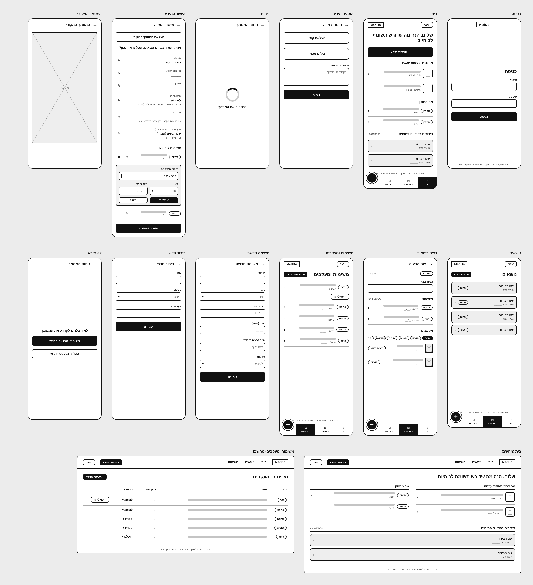
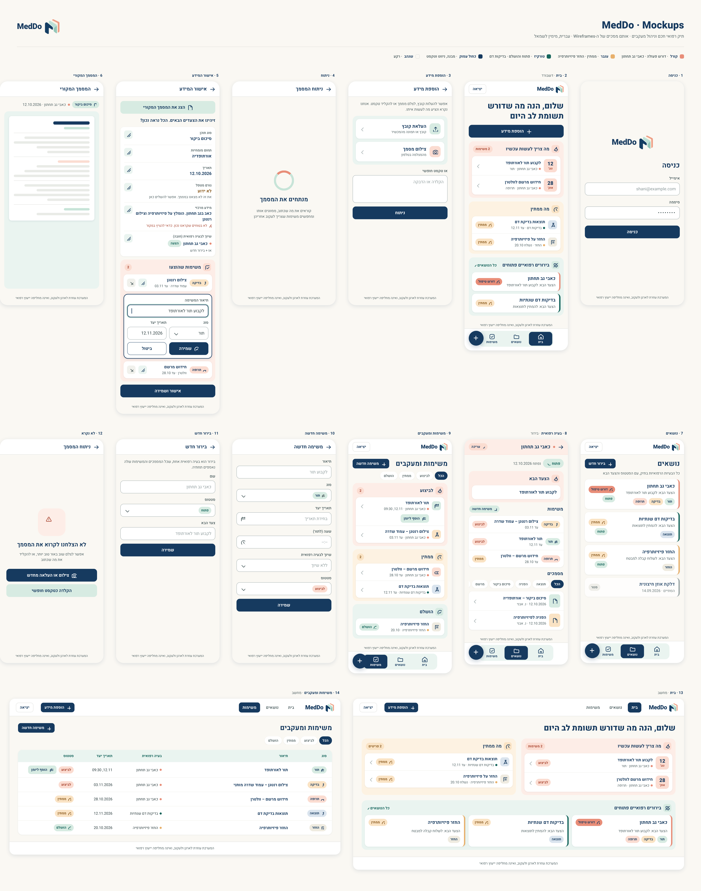
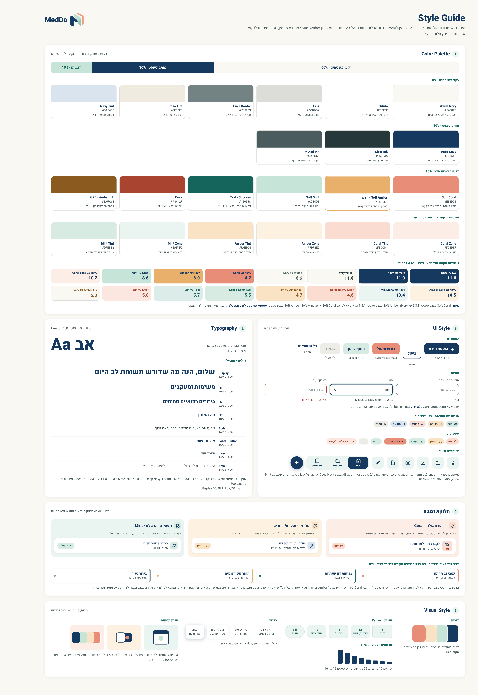

# MedDo · DESIGN

**גרסת הקורס** · 14.11.2026
נגזר מ-PRD.md. הפרטים הוויזואליים נלקחו מהתמונות בלבד.

**איך לקרוא את המסמך**
- **הנחה:** פרט שחסר ושולי. נכתב כהנחה.
- **פער:** הבדל בין התמונות ל-PRD, או רכיב ש-PRD דורש ואינו נראה בתמונות. כל פער הוכרע. רשימת ההבדלים בין התמונות לטקסט נמצאת בנספח בסוף.
- מספרי המסכים הם המספרים שב-mockups.png.

## התמונות

| תמונה | מה יש בה |
|---|---|
|  | שרטוטי המסכים בשחור-לבן: 12 מסכי טלפון ו-2 מסכי מחשב |
|  | אותם 14 מסכים, מעוצבים בצבע |
|  | צבעים, גופנים, רכיבים, חלוקת צבע וסגנון חזותי |

**כללים לכל המסכים**
- עברית, מימין לשמאל. הטלפון נבנה ברוחב 375 פיקסל. מחשב קיים רק לדשבורד ולמשימות ומעקבים.
- בתחתית כל מסך מופיעה ההבהרה הקבועה: "המערכת עוזרת לארגן ולעקוב, ואינה מחליפה ייעוץ רפואי".
- בראש הדשבורד, נושאים ומשימות ומעקבים יש לוגו MedDo וכפתור "יציאה". בשאר המסכים (כולל בעיה רפואית / בירור) יש כותרת וחץ חזרה.
- בתחתית ארבעת המסכים האלה בטלפון (דשבורד, נושאים, בעיה רפואית / בירור, משימות ומעקבים) יש סרגל ניווט (בית, נושאים, משימות) וכפתור + עגול שפותח את "הוספת מידע".
- תאריכים נכתבים כך: 12.10.2026, או 12.11 כשהשנה ברורה.

---

# חלק 1 · Screens

## 1. כניסה
**מטרה:** התחברות של המשתמשת היחידה. (הנחה: השם "כניסה" נלקח מהתמונות, ולא מה-PRD.)

**מה יש במסך:** לוגו MedDo, כותרת "כניסה", שדה "אימייל", שדה "סיסמה", כפתור ראשי "כניסה". אין הרשמה ואין סרגל ניווט.

**מה קורה:** כניסה מוצלחת מובילה ל-**דשבורד**.

## 2. דשבורד (בממשק: בית)
**מטרה:** תמונת המצב הפעילה של התיק: מה צריך לעשות עכשיו, מה ממתין, ואילו בירורים פתוחים.

**מה יש במסך (טלפון):**
- כותרת גדולה: "שלום, הנה מה שדורש תשומת לב היום".
- כפתור ראשי "הוספת מידע +".
- **מה צריך לעשות עכשיו:** אזור בצבע Coral Zone, עם מונה ("2 משימות"). כל שורה: אריח תאריך (למשל 12 נוב׳), שם המשימה, שם הבעיה הרפואית עם נקודת צבע וסוג המשימה, וחץ. משימה שתאריך היעד שלה עבר מקבלת ליד אריח התאריך תג "באיחור" (מילה ואייקון). *(הנחה: התג לא מופיע בתמונות. הוחלט ב-14.11.)*
- **מה ממתין:** אזור בצבע Amber Zone. כל שורה: אייקון סוג, שם המשימה, שם הבעיה עם נקודת צבע ותאריך, ותג "ממתין".
- **בהמשך:** אזור מקופל כברירת מחדל, מתחת ל"מה ממתין". בראשו כותרת H3 "בהמשך", מונה וחץ פתיחה. בפתיחה מוצגות שורות באותו מבנה של "מה צריך לעשות עכשיו", ממוינות לפי תאריך. רקע לבן על Warm Ivory, עם גבול Line ובלי צבע מצב, כי אין בהן דחיפות. *(הנחה: האזור לא מופיע בתמונות. הוחלט ב-14.11.)*
- "מה צריך לעשות עכשיו" מציג רק משימות "לביצוע" שתאריך היעד שלהן בתוך 14 יום מהיום, או שכבר עבר. שאר משימות "לביצוע" ב"בהמשך".
- **בירורים רפואיים פתוחים:** אזור בצבע Mint Zone, עם קישור "כל הנושאים". כל כרטיס: שם הבירור, "הצעד הבא", תג מצב ("דורש טיפול" או "ממתין") ופס צבע בצד.
- משימה שהושלמה לא מופיעה בדשבורד.

**מה יש במסך (מחשב):** סרגל ניווט עליון (בית, נושאים, משימות), "הוספת מידע +" ו"יציאה". שתי עמודות: "מה צריך לעשות עכשיו" ו"מה ממתין". מתחתיהן "בהמשך", מקופל, ברוחב מלא. מתחתיו הבירורים הפתוחים בשורה אחת. בשורות המשימות מופיע גם תג הסטטוס ("לביצוע" או "ממתין") ליד אריח התאריך.

**מה קורה:**
- "הוספת מידע" או כפתור + מובילים ל-**הוספת מידע**.
- "כל הנושאים" מוביל ל-**נושאים**. לחיצה על כרטיס בירור מובילה ל-**בעיה רפואית / בירור**.
- חץ בשורת משימה פותח את **המסמך המקורי** של המשימה. למשימה ידנית אין מסמך מקור, ולכן אין חץ. *(פער: ב-mockup החץ מופיע בכל השורות.)*
- לחיצה על תג סטטוס של משימה פותחת בחירת סטטוס. *(פער: הרכיב לא נראה ב-mockup.)*
- בכל שורת משימה (עכשיו, ממתין, בהמשך), בטלפון ובמחשב, יש כפתור קטן "בוצע" עם אייקון וי: רקע לבן, מסגרת וטקסט Teal. לחיצה מסמנת את המשימה כ"הושלם", והיא יוצאת מהדשבורד. במשימה בלי תאריך יעד נפתחת קודם בחירת הסטטוס עם שדה תאריך. *(הנחה: הכפתור לא מופיע בתמונות. הוחלט ב-15.11.)*
- **תג מצב הבירור הוא תצוגה מחושבת, לא סטטוס.** הסטטוס של בירור הוא רק פתוח או סגור. "דורש טיפול" מופיע כשיש בבירור משימה "לביצוע". "ממתין" מופיע בכל מקרה אחר: כשיש בו רק משימות "ממתין", וגם כשאין בו משימות פתוחות בכלל. לכל בירור פתוח יש תמיד אחד משני התגים.
- צבע הפס והנקודה של בירור נקבע לפי מצבו. ראו "צבע בירור" בחלק 2. *(פער: ב-mockup הפס של "בדיקות דם שנתיות" ירוק, אף שהבירור ממתין.)*

## 3. הוספת מידע
**מטרה:** הכנסת מסמך או מידע חדש לתיק. זה השלב הראשון ב-Flow הוספת מידע (קלט).

**מה יש במסך:**
- כותרת "הוספת מידע" וחץ חזרה.
- משפט הסבר: "אפשר להעלות קובץ, לצלם מסמך או להקליד טקסט. אנחנו נקרא ונציע מה לעשות איתו."
- אזור בצבע Mint Zone עם שתי שורות:
  - "העלאת קובץ", עם התיאור "קובץ או תמונה מהמכשיר".
  - "צילום מסמך", עם התיאור "מהמצלמה בטלפון".
- שדה טקסט "או טקסט חופשי", עם הרמז "הקלדה או הדבקה".
- כפתור ראשי "ניתוח".

**מה קורה:**
- "ניתוח" שולח את הטקסט לניתוח ומוביל ל-**ניתוח**.
- (הנחה: אחרי בחירת קובץ או צילום, המסך עובר ל-**ניתוח** אוטומטית. ב-mockup אין כפתור נפרד לזה.)
- חץ החזרה חוזר למסך שממנו הגיעו.

## 4. ניתוח
**מטרה:** להראות שהמערכת עובדת בזמן שהמודל מנתח את המסמך.

**מה יש במסך:** כותרת "ניתוח המסמך", עיגול טעינה (קשת Soft Coral על טבעת Soft Mint), הכותרת "מנתחים את המסמך" וההסבר "קוראים את מה שכתוב, מסווגים אותו ומחפשים משימות שצריך לעקוב אחריהן".

**מה קורה:** אין פעולה למשתמשת. אם הניתוח הצליח, עוברים ל-**אישור המידע**. אם לא, עוברים ל-**לא נקרא**.

## 5. אישור המידע
**מטרה:** לבדוק מה חולץ, לתקן, לשייך לבעיה רפואית ולאשר. שום דבר לא נשמר לפני האישור.

**מה יש במסך:**
- כפתור רך "הצג את המסמך המקורי", בראש המסך.
- השאלה "זיהינו את הצעדים הבאים. הכל נראה נכון?"
- כרטיס עם השדות: סוג תוכן, תחום מומחיות, תאריך, גורם מטפל, מידע מרכזי, ושיוך לבעיה רפואית (חובה). ליד כל שדה כפתור עיפרון לעריכה.
- פרט שלא נמצא מוצג "לא ידוע" בצבע Amber Ink, עם משפט: "את זה לא מצאנו במסמך. אפשר להשלים כאן".
- פרט לא ודאי מסומן באייקון ובמשפט בצבע Error: "לא בטוחים שקראנו נכון. כדאי להציץ במקור".
- שדה השיוך מציג את שם הבעיה המוצעת עם נקודת צבע ותג "הצעה", ומתחתיו "או + בירור חדש".
- אזור "משימות שהוצעו" בצבע Coral Zone, עם מונה. בכל שורה: כפתור ✕ למחיקה, כפתור עיפרון לעריכה, שם המשימה, תג סוג ותאריך יעד.
- עריכת משימה נפתחת בתוך הכרטיס, עם שדות: תיאור המשימה, סוג, סטטוס ("לביצוע" כברירת מחדל), תאריך יעד, וכפתורים "שמירה" ו"ביטול". *(הנחה: שדה הסטטוס לא מופיע בתמונות. הוחלט ב-14.11.)*
- כפתור ראשי "אישור ושמירה" בתחתית.

**מה קורה:**
- "הצג את המסמך המקורי" מוביל ל-**המסמך המקורי**.
- "+ בירור חדש" מוביל ל-**בירור חדש**.
- ✕ מוחק משימה שהוצעה.
- תאריך יעד הוא שדה חובה, חוץ ממשימה "ממתין". כשהוא חסר במשימה "לביצוע", השדה מקבל מצב שגיאה: "צריך תאריך כדי לשמור". במשימה "ממתין" השדה רשות, בלי שגיאה.
- כשסוג המשימה הוא "תור", מופיע בעריכה גם שדה שעה. *(פער: השדה לא נראה במסך הזה ב-mockup.)*
- "אישור ושמירה" שומר את המסמך והמשימות ומוביל ל-**דשבורד**, שמתעדכן. אי אפשר לשמור בלי שיוך לבעיה רפואית.

## 6. המסמך המקורי
**מטרה:** לבדוק את המסמך עצמו מול מה שחולץ ממנו.

**מה יש במסך:** כותרת "המסמך המקורי" וחץ חזרה. שורת פרטים: תג סוג תוכן (למשל "סיכום ביקור"), נקודת צבע ושורה "12.10.2026 · כאבי גב תחתון". תצוגת המסמך בתוך לוח בצבע Mint Tint.
- **תמונה:** מוצגת בתוך הלוח.
- **טקסט חופשי:** הטקסט שהוקלד מוצג בתוך הלוח.
- **PDF:** בתוך הלוח יש כפתור רך "פתיחת הקובץ", שפותח את הקובץ בלשונית חדשה. *(הנחה: הכפתור לא מופיע בתמונות. PDF לא מוצג בתוך המסך, כי זה לא עובד טוב בטלפון.)*
- **מתוך אישור המידע** (לפני שמירה): בלי שורת הפרטים, כי הם עוד לא אושרו.

**מה קורה:** חץ החזרה חוזר למסך שממנו פתחו. בחזרה ל-**אישור המידע** כל התיקונים נשמרים. המסך נפתח מ-**אישור המידע**, משורת מסמך ב-**בעיה רפואית / בירור**, ומחץ של משימה שנוצרה ממסמך.

## 7. נושאים
**מטרה:** רשימת כל הבעיות הרפואיות (הבירורים), עם מצב וצעד הבא.

**מה יש במסך:**
- כותרת "נושאים", כפתור ראשי "בירור חדש +" והסבר: "כל הבעיות הרפואיות בתיק, עם הסטטוס והצעד הבא".
- כרטיס לכל בירור, עם פס צבע בצד: שם הבירור, "הצעד הבא", תג מצב מחושב ("דורש טיפול" או "ממתין"), תג הסטטוס "פתוח", ותגיות של סוגי המשימות הפתוחות של הבירור (תור, בדיקה, תרופה, תוצאה, החזר). התגיות הן סיכום מחושב. (הנחה: זה מה שהן מציגות, לפי הדוגמאות בתמונות.)
- בירור סגור מוצג בכרטיס דהוי, עם שם הבירור ותג "סגור" בלבד, בלי תאריך. *(פער: ב-mockup מופיע "הסתיים · 14.09.2026".)*
- סרגל ניווט, עם "נושאים" פעיל.

**מה קורה:** "בירור חדש" מוביל ל-**בירור חדש**. לחיצה על כרטיס מובילה ל-**בעיה רפואית / בירור**.

## 8. בעיה רפואית / בירור
**מטרה:** כל המידע על בעיה רפואית אחת: הצעד הבא, משימות ומסמכים.

**מה יש במסך:**
- כותרת באזור Coral Zone: שם הבירור, נקודת צבע, חץ חזרה וכפתור "עריכה".
- תג הסטטוס "פתוח" ושורה "נפתח 12.10.2026".
- **הצעד הבא:** אזור צבעוני עם תיבה לבנה בתוכה ("לקבוע תור לאורתופד").
- **משימות:** כותרת וכפתור "משימה חדשה". כל שורה: שם המשימה, "עד 03.11", תג סוג ותג סטטוס. משימה שהושלמה נשארת ברשימה.
- **מסמכים:** שורת סינון לפי סוג תוכן (הכל, תוצאה, הפניה, סיכום ביקור, מרשם, קבלה). השורה נגללת לצדדים. כל שורת מסמך: אריח אייקון, שם המסמך, "12.10.2026 · נ. אבני" (תאריך וגורם מטפל) וחץ.
- סרגל ניווט, עם "נושאים" פעיל.

**מה קורה:**
- "עריכה" פותחת את **בירור חדש** במצב עריכה, עם הערכים הקיימים. שם, סטטוס (פתוח או סגור) וצעד הבא נערכים שם. *(הנחה: ניסוח הכותרת במצב עריכה לא מופיע בתמונות.)*
- "משימה חדשה" מוביל ל-**משימה חדשה**.
- סינון המסמכים משנה את הרשימה במקום.
- לחיצה על שורת מסמך פותחת את **המסמך המקורי**.
- חץ בשורת משימה פותח את המסמך המקורי שלה (כמו בדשבורד). לחיצה על תג הסטטוס פותחת בחירת סטטוס.
- *(פער: תאריך הפתיחה לא מופיע ב-PRD. הוכרע להוסיף אותו שם.)*

## 9. משימות ומעקבים
**מטרה:** כל המשימות במקום אחד, עם סוג, סטטוס ותאריך יעד.

**מה יש במסך (טלפון):**
- כותרת "משימות ומעקבים" וכפתור ראשי "משימה חדשה +".
- שורת סינון לפי סטטוס: הכל, לביצוע, ממתין, הושלם.
- המשימות מקובצות לפי סטטוס: "לביצוע" (Coral Zone), "ממתין" (Amber Zone) ו"הושלם" (Mint Zone). בראש כל קבוצה מונה.
- כל שורה: שם המשימה, תאריך יעד (לתור גם שעה), שם הבעיה הרפואית עם נקודת צבע, תג סוג וחץ. משימה "לביצוע" או "ממתין" שתאריך היעד שלה עבר מקבלת ליד התאריך תג "באיחור". במחשב התג מופיע בעמודת תאריך היעד. בכל שורת תור יש גם כפתור רך "הוסף ליומן", תמיד פעיל, גם כשלתור אין שעה.
- סרגל ניווט, עם "משימות" פעיל.

**מה יש במסך (מחשב):** סרגל ניווט עליון עם "משימות" פעיל. מעל הטבלה יש כפתור "משימה חדשה +" ושורת הסינון. הטבלה כוללת את העמודות סוג, תיאור, בעיה רפואית, תאריך יעד וסטטוס. בכל שורת תור יש גם כפתור "הוסף ליומן", תמיד פעיל, גם כשלתור אין שעה.

**מה קורה:**
- "משימה חדשה" מוביל ל-**משימה חדשה**.
- סינון הסטטוס מציג רק את הקבוצה שנבחרה.
- חץ בשורה פותח את **המסמך המקורי** של המשימה. למשימה ידנית אין חץ. *(פער: ב-mockup יש חץ בכל השורות.)*
- לחיצה על תג הסטטוס פותחת בחירת סטטוס, והמשימה עוברת לקבוצה המתאימה. *(פער: בטלפון תג הסטטוס לא מופיע ב-mockup בשורות "לביצוע" ו"ממתין". בקבוצות הוא נקבע לפי הקבוצה. במחשב ה-wireframe הראה תפריט בעמודת הסטטוס, וה-mockup הסיר אותו.)*
- "הוסף ליומן" נשאר פעיל תמיד. כשלתור אין שעה, לחיצה עליו פותחת חלונית שמבקשת להוסיף שעה. אחרי שמולאה שעה, נפתח Google Calendar עם שם התור, התאריך והשעה, והמשתמשת לוחצת שמירה. *(פער: החלונית לא נראית בתמונות. הנחה: היא מבקשת את מה שחסר, שעה, ואם חסר גם תאריך.)*
- *(פער: הסינון, הקיבוץ ועמודת "בעיה רפואית" לא הופיעו ב-PRD. הוכרע להוסיף אותם.)*

## 10. משימה חדשה / עריכת משימה
**מטרה:** יצירת משימה ידנית, שלא הגיעה ממסמך, ועריכה או מחיקה של משימה קיימת.

**מה יש במסך:** כותרת "משימה חדשה" וחץ חזרה. שדות: תיאור (הרמז "לקבוע תור"), סוג (רשימה, למשל "תור"), תאריך יעד (הרמז "בחירת תאריך"), שעה (לתור) (הרמז "--:--"), שיוך לבעיה רפואית (הרמז "ללא שיוך") וסטטוס (למשל "לביצוע"). כפתור ראשי "שמירה".

**מצב עריכה:** נפתח בלחיצה על שורת משימה, בדשבורד, במשימות ומעקבים ובמסך הבעיה (לא על תג הסטטוס ולא על החץ). הכותרת "עריכת משימה", והשדות מלאים בערכים הקיימים. במשימה שנוצרה ממסמך שדה השיוך מוצג אבל לא ניתן לשינוי, כי הבעיה נקבעת לפי המסמך. במשימה ידנית אפשר לשנות אותו. מתחת לכפתור "שמירה" יש כפתור טקסט "מחיקה" בצבע Error. לחיצה עליו פותחת חלון אישור: "למחוק את המשימה? אי אפשר לבטל את זה", עם "מחיקה" (כפתור ראשי) ו"ביטול" (משני). *(הנחה: מצב העריכה, כפתור המחיקה וחלון האישור לא מופיעים בתמונות. הוחלט ב-14.11.)*

**מה קורה:** "שמירה" שומרת את המשימה וחוזרת למסך שממנו הגיעו. (הנחה.) "מחיקה" שאושרה מוחקת את המשימה וחוזרת למסך שממנו הגיעו. תאריך יעד הוא שדה חובה, חוץ מכשהסטטוס "ממתין". שאר השדות בטופס נשארים כמו ב-PRD.

## 11. בירור חדש
**מטרה:** פתיחה ידנית של בעיה רפואית. המערכת לא פותחת בירור בעצמה.

**מה יש במסך:** כותרת "בירור חדש" וחץ חזרה. משפט הסבר: "בירור הוא בעיה רפואית אחת, שכל המסמכים והמשימות שלה נאספים תחתיה". שדות: שם (הרמז "כאבי גב תחתון"), סטטוס (למשל "פתוח") וצעד הבא (הרמז "לקבוע תור לאורתופד"). כפתור ראשי "שמירה".

**מה קורה:** "שמירה" שומרת וחוזרת למסך שממנו הגיעו: **נושאים** או **אישור המידע**. (הנחה: במקרה השני הבירור החדש נבחר אוטומטית בשדה השיוך.) מסך זה משמש גם לעריכת בירור קיים.

## 12. לא נקרא
**מטרה:** להסביר שהמודל לא הצליח לקרוא את המסמך, ולהציע דרך להמשיך. המסמך לא נשמר.

**מה יש במסך:** כותרת "ניתוח המסמך". אריח בצבע Coral Tint עם אייקון אזהרה. כותרת "לא הצלחנו לקרוא את המסמך" והסבר: "אפשר לצלם שוב באור טוב יותר, או להקליד את מה שכתוב". כפתור ראשי "צילום או העלאה מחדש" וכפתור רך "הקלדה כטקסט חופשי".

**מה קורה:** שני הכפתורים מובילים ל-**הוספת מידע**. (הנחה: השני פותח אותו על שדה הטקסט.) המסך מופיע גם כשפלט המודל לא במבנה הצפוי.

## 13. דשבורד (מחשב)
אותו מסך כמו מסך 2, בפריסת מחשב. ראו מסך 2.

## 14. משימות ומעקבים (מחשב)
אותו מסך כמו מסך 9, בפריסת מחשב. ראו מסך 9.

## הניווט בין המסכים

- **כניסה** מובילה ל-**דשבורד**.
- בטלפון עוברים בין **דשבורד**, **נושאים** ו-**משימות ומעקבים** בסרגל התחתון. במחשב הניווט בכרטיסיות העליונות.
- **הוספת מידע** נפתחת מכפתור "הוספת מידע" או מכפתור +, מכל מקום. הסדר: **הוספת מידע**, **ניתוח**, **אישור המידע**, ושמירה שמחזירה ל-**דשבורד**. אם הניתוח נכשל, עוברים ל-**לא נקרא** וחוזרים ל-**הוספת מידע**.
- **נושאים** מובילים ל-**בעיה רפואית / בירור**, ומשם ל-**משימה חדשה**, ל-**בירור חדש** (עריכה) ול-**המסמך המקורי**.
- **המסמך המקורי** נפתח מ-**אישור המידע**, משורת מסמך בבעיה רפואית, ומחץ של משימה שנוצרה ממסמך.
- חץ החזרה בכל מסך זרימה או טופס חוזר למסך הקודם.

---

# חלק 2 · Style Guide

האווירה הכללית: רגועה, חמה ומסודרת. רקע שנהב חם, כחול עמוק לטקסט ולכפתורים, ודגשים רכים בקורל, בענבר ובמנטה. הצורות מעוגלות והעברית פשוטה ומרגיעה. המטרה היא תחושה של סדר, בלי אזעקה.

## צבעים

חלוקה של 60-30-10: 60% רקע ומשטחים, 30% מותג וטקסט, 10% דגשים וצבעי מצב.

### 60% · רקע ומשטחים

| שם | HEX | שימוש |
|---|---|---|
| Warm Ivory | #FAF8F3 | רקע מרכזי של כל המסכים |
| White | #FFFFFF | כרטיסים, רשימות ושדות |
| Line | #DCDDD9 | קווים וגבולות, ניטרלי |
| Field Border | #738283 | גבול שדה (3.9:1 מול לבן) |
| Stone Tint | #EFEBE0 | תג סוג "החזר" |
| Navy Tint | #DAE4EE | תג סוג "תוצאה" |

### 30% · מותג וטקסט

| שם | HEX | שימוש |
|---|---|---|
| Deep Navy | #163A5F | כותרות, כפתור ראשי, ניווט |
| Slate Ink | #26383A | טקסט רץ ואייקונים |
| Muted Ink | #4A5C5E | טקסט משני, ניטרלי נוסף |

### 10% · דגשים וצבעי מצב

| שם | HEX | שימוש |
|---|---|---|
| Soft Coral | #E88D78 | דורש פעולה. הטקסט עליו רק Navy |
| Soft Amber | #E8B06B | ממתין. הטקסט עליו רק Navy |
| Soft Mint | #C7E4D8 | אזור רגוע, פוקוס, חיובי |
| Teal · Success | #15655C | פתוח והושלם. רקע: #DCEDE9 |
| Error | #A8442F | שגיאה. רקע: #FBE7E0 |
| Amber Ink | #8A5A1E | טקסט "ממתין" על רקע ענבר |

### טינטים · רקעי אזור ותגיות

| שם | HEX | שימוש |
|---|---|---|
| Coral Zone | #FDEDE7 | רקע אזור "דורש פעולה" |
| Coral Tint | #FBDCD1 | תגית, אייקון, אריח תאריך |
| Amber Zone | #FDF2E2 | רקע אזור "ממתין" |
| Amber Tint | #FAE3C4 | תגית ממתין, תג סוג "בדיקה" |
| Mint Zone | #EAF4F0 | רקע אזור נושאים וניווט |
| Mint Tint | #D7EBE2 | תגית פתוח והושלם, תג סוג "תור" |

### חלוקת הצבע לפי תפקיד

- **Coral · דורש פעולה:** מה צריך לעשות עכשיו, משימות "לביצוע", משימות שהוצעו, תג "דורש טיפול".
- **Amber · ממתין:** תוצאה שטרם התקבלה, החזר שטרם שולם, תור עתידי שנקבע.
- **Mint · נושאים והושלם:** רשימת הבירורים, מסמכים, סרגל הניווט ומשימות שהושלמו.
- **צבע בירור:** הצבע של הפס בצד הכרטיס ושל הנקודה ליד כל פריט שלו נקבע לפי מצב הבירור, ולא לפי התוכן הרפואי.
  - דורש טיפול: Coral #E88D78.
  - ממתין: Amber #E8B06B.
  - סגור: Slate #8C9A9B.
- בתיק מוצגים עד שלושה גוונים בבת אחת, כדי שיישארו קריאים. נושא לעולם לא מזוהה בצבע בלבד: ליד הפס יש תמיד שם הבירור.
- בירור סגור מוצג בכרטיס דהוי, בערך 83% שקיפות של אותם צבעים. (הנחה: לפי מדידת ה-mockup, ולא לפי המדריך.)

### ניגודיות (נדרש 4.5:1 לפחות לטקסט)

| צמד | ניגודיות |
|---|---|
| Deep Navy ו-White | 11.6 |
| Deep Navy ו-Warm Ivory | 11.0 |
| Slate Ink ו-Warm Ivory | 11.6 |
| Muted Ink ו-Warm Ivory | 6.6 |
| Deep Navy על Soft Coral | 4.7 |
| Deep Navy על Soft Amber | 6.0 |
| Deep Navy על Soft Mint | 8.6 |
| Deep Navy על Coral Zone | 10.2 |
| Deep Navy על Amber Zone | 10.5 |
| Deep Navy על Mint Zone | 10.4 |
| Error על Coral Tint | 4.6 |
| Amber Ink על Amber Tint | 4.7 |
| Amber Ink על Warm Ivory | 5.3 |
| Teal על Mint Tint | 5.5 |
| Teal על #DCEDE9 | 5.7 |
| Error על #FBE7E0 | 5.0 |

**אסור:**
- Soft Coral כצבע טקסט (2.3:1 על Ivory).
- Soft Amber כצבע טקסט (1.8:1 על Ivory).
- טקסט לבן על Soft Coral, על Soft Amber או על Soft Mint.
- סטטוס בצבע בלבד: תמיד מילה ואייקון לצד הצבע.

**הערה:** ב-mockup גבול השדה הוא #9AA7A8, וה-placeholder והחצים הם #8E9B9C. הם בהירים מהמדריך (ניגודיות 2.5:1 ו-2.9:1). ה-DESIGN קובע לפי המדריך: גבול שדה #738283, placeholder ב-Muted Ink #4A5C5E וחצים ב-Field Border #738283. *(פער: ה-mockup צריך להתעדכן.)*

## גופנים

- **גופן:** Heebo, במשקלים 400, 500, 700 ו-800. גופן עברי אמיתי, עגלגל וברור, קרוב לאופי שם המוצר בלוגו.
- כותרות ב-Deep Navy. טקסט רץ ב-Slate Ink. אף טקסט לא קטן מ-14.
- שם המוצר MedDo תמיד באותיות לטיניות, במשקל 800.

| סגנון | גודל / גובה שורה · משקל | דוגמה |
|---|---|---|
| Display | 32/40 · 800 (מחשב: 40/48) | "שלום, הנה מה שדורש תשומת לב היום" |
| H1 | 26/34 · 700 (מחשב: 32/40) | "משימות ומעקבים" |
| H2 | 22/30 · 700 | "בירורים רפואיים פתוחים" |
| H3 | 18/26 · 700 | "מה ממתין" |
| Body | 16/26 · 400 | "זיהינו את הצעדים הבאים. הכל נראה נכון?" |
| Label · Button | 16/20 · 700 | "אישור ושמירה" |
| שדה | 14/20 · 600 | "תאריך יעד" |
| Small | 14/22 · 400 | ההבהרה הקבועה |

## כפתורים ורכיבים

גובה מגע מינימלי: 48 פיקסל.

**כפתורים**

| סוג | מראה | דוגמה |
|---|---|---|
| ראשי | רקע Navy, טקסט לבן | "הוספת מידע +" |
| משני | מסגרת Navy, רקע לבן | "ביטול" |
| דגש | רקע Coral, טקסט Navy | "דורש טיפול" |
| רך | רקע Mint Tint, טקסט Navy | "הוסף ליומן" |
| לא פעיל | רקע אפור בהיר, טקסט אפור | "שמירה" |
| טקסט | טקסט עם קו תחתון | "כל הנושאים" |

**שדות**
- רגיל: רקע לבן, מסגרת Field Border (#738283).
- בפוקוס: מסגרת Navy והילה בצבע Mint.
- שגיאה: מסגרת Error והודעה מתחת, למשל "צריך תאריך כדי לשמור".
- פרט שלא נמצא במסמך מוצג "לא ידוע" בצבע Amber Ink, עם משפט הסבר קצר מתחתיו.
- הרמז (placeholder): לפי ההערה בסעיף הצבעים.

**תגיות סוג משימה** (צבע לכל סוג, עם אייקון ומילה): תור Mint Tint, בדיקה Amber Tint, תרופה Coral Tint, תוצאה Navy Tint, החזר Stone Tint.

**תגיות סטטוס** (תמיד מילה ואייקון):

| תגית | רקע | טקסט |
|---|---|---|
| לביצוע | Coral Tint | Error |
| ממתין | Amber Tint | Amber Ink |
| הושלם | #DCEDE9 | Teal |
| דורש טיפול | Soft Coral | Deep Navy |
| פתוח | #DCEDE9 | Teal |
| סגור | אפור בהיר | Muted Ink |
| לא הצלחנו לקרוא | #FBE7E0 | Error |
| באיחור | #FBE7E0 | Error |

(הנחה: הצמדת הצבעים לתגיות נלקחה מזוגות הניגודיות במדריך, ושל "סגור" מהתמונה. אין במדריך רשימה מפורשת.)

**אייקונים וניווט**
- אייקונים בקו אחיד בעובי 2, קצוות וחיבורים מעוגלים כמו פינות הלוגו. גודל 24 פיקסל, באזור מגע 48.
- צבע Deep Navy, או לבן על Navy.
- סרגל הניווט התחתון יושב על Mint Zone, והפריט הפעיל ב-Navy מלא, עם אייקון ומילה.
- כפתור + עגול ב-Deep Navy, עם צל גבוה.
- בניווט העליון במחשב, הכרטיסייה הפעילה היא כפתור Navy מלא.

**אזורים וכרטיסים**
- כרטיס לבן על אזור צבעוני (Coral, Amber או Mint Zone). בראש האזור כותרת H3, אייקון ומונה.
- כרטיס בירור: פס צבע בצד, וניתן לראות שם הבירור, "הצעד הבא" ותגיות.
- אריח תאריך בצבע Coral Tint ("12 נוב׳"), עם Error על הטקסט.
- שורות ברשימה מופרדות בקו Line דק.

**מצבים**
- טעינה: עיגול עם קשת Soft Coral על טבעת Soft Mint.
- שגיאת קריאה: אריח Coral Tint עם אייקון אזהרה.

## פינות וצורות

| רדיוס | שימוש |
|---|---|
| 8 | ציפ (רכיב קטן) |
| 12 | כפתור ושדה |
| 16 | כרטיס |
| 18 | אזור צבע |
| Pill | תגית |

- **צורות:** דפים מעוגלים בשכבות, עם קו לבן דק ביניהם. המקור הוא הלוגו.
- **צללים:**
  - ללא צל: שדות ורשימות.
  - קל: כרטיס, 0 1 4, בשקיפות 8%.
  - בינוני: לוח, 0 2 10, בשקיפות 10%.
  - גבוה: כפתור + וחלון.
  - צללים בגוון Navy בלבד, אף פעם לא שחור.
- **סגנון תמונות:** איורים שטוחים בלבד: צורות מעוגלות בצבעי הפלטה, בלי צללים כבדים. אין תצלומי רופאים או אנשים, ואין טקסט בתוך תמונות.

## מרווחים

- כפולות של 4.
- שוליים: 16 בטלפון, 32 במחשב.
- בין כרטיסים: 12 עד 16.

## נגישות (לפי ה-PRD)

- ניגודיות שעוברת את התקן, לפי טבלת הניגודיות למעלה.
- תווית לכל שדה (נראית בכל הטפסים).
- טקסט חלופי לכל תמונה.
- ניווט מלא במקלדת. מצב הפוקוס מוגדר בסעיף השדות.
- *(הערה: טקסט חלופי וניווט במקלדת אינם נראים בתמונות. הם נכתבו כדרישה.)*

---

# נספח · הבדלים בין התמונות לטקסט

התמונות לא יעודכנו. בכל מקום שבו הן שונות מהרשימה הזו, הטקסט ב-DESIGN.md קובע.

**ב-mockups.png, ובמקום המתאים גם ב-wireframes.png ו-style-guide.png:**
1. שדה שעה בעריכת משימה במסך אישור המידע, כשהסוג הוא "תור".
2. חלונית "הוסף שעה" ללחיצה על "הוסף ליומן" בלי שעה.
3. תג סטטוס לחיץ בשורות המשימות, כולל שורות הטלפון במסך משימות ומעקבים.
4. החץ בשורת משימה רק במשימה שנוצרה ממסמך.
5. גבול שדה #738283, placeholder #4A5C5E וחצים #738283, במקום #9AA7A8 ו-#8E9B9C.
6. בירור סגור: בלי תאריך "הסתיים".
7. פס "בדיקות דם שנתיות" בצבע לפי מצב הבירור (Amber, כי הבירור ממתין).
8. אין מצב בירור "רגוע" ואין פס Teal לבירור (ב-style-guide.png הוא מופיע). בירור פתוח בלי משימות פתוחות הוא "ממתין", בצבע Amber.
9. אזור "בהמשך" בדשבורד, בטלפון ובמחשב.
10. תג "באיחור" בשורות משימה שתאריך היעד שלהן עבר.
11. שדה סטטוס בעריכת משימה במסך אישור המידע.
12. מצב עריכה של "משימה חדשה", כפתור "מחיקה" וחלון אישור המחיקה.
13. כפתור "בוצע" בשורות המשימה בדשבורד.
